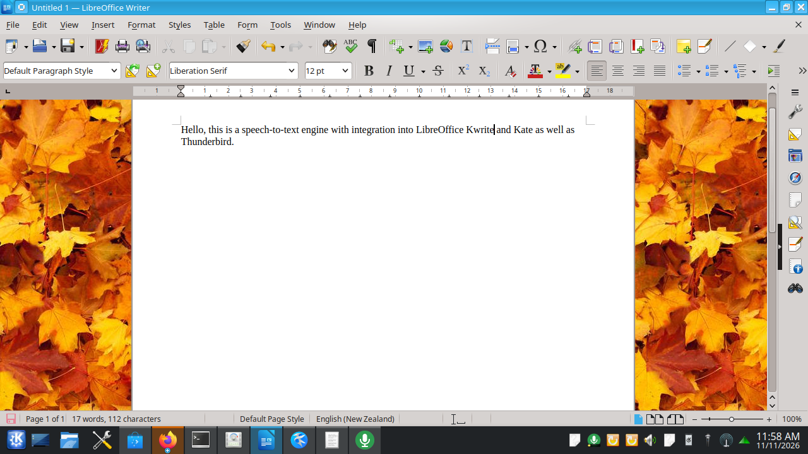
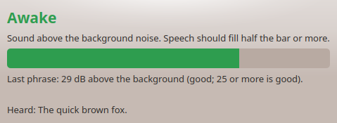
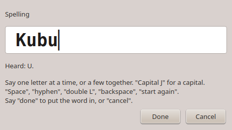
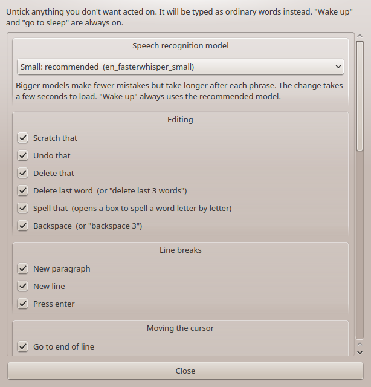

# Linux Speaking

Voice dictation for the KDE Plasma desktop that works *with* your programs instead of just
typing at them. Say **"wake up"**, talk, and your words go into LibreOffice Writer,
Thunderbird, Kate or KWrite with the spacing and capitals already right for where the
cursor is. Edit by voice with commands like **"scratch that"**, **"select"** and
**"spell that"**.

It runs entirely on your own computer, using [Whisper](https://github.com/openai/whisper)
for speech recognition. Nothing you say is sent anywhere, and no graphics card is needed.



It was inspired by how Dragon NaturallySpeaking worked with Microsoft Word: the dictation
program knew what text was around the cursor. Linux Speaking is an independent project and
has no connection with Dragon or its makers.

## What it does

- **Wake up and go to sleep by voice.** No push-to-talk key. While asleep it listens only
  for "wake up".
- **Fits what you say to the document.** Put the cursor after a full stop and the next
  phrase starts with a space and a capital. Put it mid-sentence and it doesn't.
- **Punctuation by name.** "Comma", "full stop" or "period", "question mark", "new line",
  "new paragraph".
- **Editing commands.** Scratch that, undo that, backspace, delete last word, select a
  word or phrase, then dictate over the selection to replace it.
- **Numbered choices.** If "select fox" matches several places, a small number appears
  over each and you say which one.
- **Spell that.** A box opens and you spell a word letter by letter.
- **A tray icon** that shows whether it is off, asleep, awake or hearing you, with a
  microphone level meter that turns red when the microphone is too loud.
- **Settings** to switch any command or punctuation word on or off, and to choose the
  speech model.

| | |
|---|---|
|  | Loading, off, asleep, awake, and too loud |
|  | The level meter window |
|  | "Spell that" |
|  | Settings |

## What you need

- KDE Plasma, on Wayland or X11. It was built and tested on Kubuntu 26.04.
- A microphone. A headset works best, because an open microphone also hears your speakers.
- LibreOffice Writer, and optionally Thunderbird, Kate or KWrite.
- About 1.5 GB of disk space, most of it the speech models.
- A reasonably recent processor. On an 8-core laptop chip a phrase takes about a second
  to appear after you stop speaking.

## Installing

```
git clone https://github.com/jontio/linux-speaking
cd linux-speaking
./install.sh
```

The installer asks for your password once, to install system packages. Everything else
goes in `~/linux-speaking` in your home folder. It then:

1. sets up the speech engine and downloads two speech models (about 650 MB),
2. installs the LibreOffice Writer extension,
3. builds the Thunderbird add-on,
4. lets Kate and KWrite be dictated into,
5. adds "Linux Speaking" to the application menu, under Utilities,
6. starts the tray icon, now and at every login.

Run `./install.sh` again at any time to update. `./uninstall.sh` removes everything except
the system packages.

### The one manual step: Thunderbird

Thunderbird doesn't let another program install an add-on, so if you use it:

1. In Thunderbird, open the menu and choose **Add-ons and Themes**.
2. Click the gear icon and choose **Install Add-on From File**.
3. Pick `~/linux-speaking/linux-speaking-thunderbird.xpi`.
4. Open a new message or reply. Compose windows that were already open won't have it.

### How well tested is the installer?

Honestly: only partly. It has been run on one Kubuntu 26.04 machine that already had the
system packages. It has **not** yet been run on a freshly installed system, and the package
lists for Fedora, Arch and openSUSE are untested. If it fails for you, please open an issue
with the output.

## Using it

1. Click into a Writer document, a Thunderbird message, or a Kate or KWrite window.
2. Say **"wake up"**. The tray icon turns green.
3. Talk in phrases. Text appears each time you pause.
4. Say **"go to sleep"** when you are done.

Words go to whichever supported window is in front. Hover over the tray icon to see which.
A command is a phrase said on its own, with a short pause before and after. Said in the
middle of a sentence, the same words are just typed.

Clicking the tray icon turns the microphone off or on. Right-clicking it gives you the
level meter, Settings and About.

### Commands

| Say | What happens |
|---|---|
| wake up / go to sleep | Starts and stops dictation |
| scratch that | Removes the last phrase; say it again for the one before |
| undo that | Undoes the last change |
| backspace, backspace 3 | Removes characters before the cursor |
| delete last word, delete last 3 words | Removes words before the cursor |
| delete that | Removes the selection |
| select *words* | Selects those words near the cursor, with numbered choices if several match |
| select that / unselect that | Selects the last phrase / clears the selection |
| spell that | Opens the spelling box |
| new paragraph, new line, press enter | Breaks |
| go to end of line / start of line | Moves the cursor |
| go to end of paragraph / start of paragraph | Moves the cursor; say again to carry on to the next |
| go to top / go to bottom | Moves to the start or end of the document |
| cap that, all caps that, no caps that | Changes the case of the selection or last phrase |
| bold that, italicize that, underline that | Formats the selection or last phrase (not in Kate) |

Punctuation words, said while dictating: comma, full stop, period (off by default),
question mark, exclamation mark, colon, semicolon, hyphen, ellipsis, open and close
bracket, open and close quote. Say "literal comma" to type the word itself.

In the spelling box, say letters one at a time or several together. Letter names and the
radio alphabet both work. "Capital J" gives a capital. "Space", "hyphen", "double L",
"backspace" and "start again" do what they say. "Done" puts the word in, "cancel" doesn't.

### Differences between programs

- **Kate and KWrite** are plain text, so there is no bold or italic, "new paragraph" leaves
  a blank line, and "select" takes the nearest match without showing numbers. Start them
  from the application menu, not a terminal, or dictation can't see them.
- **Thunderbird** works in the message body only, not the address or subject boxes.

## Settings and speech models

The Settings window lets you untick any command or punctuation word. Unticked, the words
are typed as ordinary text.

It also lets you choose the speech model. The installer provides Base and Small. Small is
the default. Bigger models make fewer mistakes but take longer after each phrase. Any
[faster-whisper](https://github.com/SYSTRAN/faster-whisper) model placed in
`~/linux-speaking/models/` appears in the list.

## If something isn't working

- **"Wake up" is ignored.** Open the level meter from the tray icon and speak. The bar
  should fill at least half way. If it barely moves, the microphone is too quiet or the
  wrong one is selected in your sound settings. If it turns red, it is too loud.
- **Words don't appear.** Hover over the tray icon. It says which program it is typing
  into, or that nothing suitable is in front.
- **Nothing works in Writer after an update.** If LibreOffice was open during the update,
  the new extension is waiting. Close LibreOffice for ten seconds and reopen it.
- **Kate isn't picked up.** Close Kate and start it again from the application menu.
- **A log** of what the engine is doing: `journalctl --user -u linux-speaking -f`.
  Dictated text is never written to the log, only its length.
- **To see why "wake up" was missed,** turn on extra logging with
  `systemctl --user edit linux-speaking`, add the two lines `[Service]` and
  `Environment=LS_LOG_PHRASES=1`, and restart the service. The log then shows the length
  and loudness of each phrase heard while asleep, and the text of phrases of three words
  or fewer. It is off by default.

## How it works

A speech engine listens to the microphone, cuts what you say into phrases at each pause,
and runs Whisper on each one. It decides whether a phrase is a command or dictation, reads
the text around the cursor from the program in front, fits the words to it, and asks that
program to insert them. Each program is reached a different way: a LibreOffice extension,
a Thunderbird add-on, and the desktop's accessibility interface for Kate and KWrite.

[docs/DESIGN.md](docs/DESIGN.md) has the details, including how to add another program.

## Developing

The rule tests need only Python 3.10 or newer:

```
python3 -m unittest discover -s tests -t .
```

The others drive real programs and are described in [docs/DESIGN.md](docs/DESIGN.md).
See [CONTRIBUTING.md](CONTRIBUTING.md) for how to report a problem or send a change, and
[CHANGELOG.md](CHANGELOG.md) for what has changed.

## Licence

Linux Speaking is free software under the
[GNU General Public License, version 3](LICENSE) or (at your option) any later version.
It comes with no warranty.

It builds on OpenAI's Whisper, [faster-whisper](https://github.com/SYSTRAN/faster-whisper),
[CTranslate2](https://github.com/OpenNMT/CTranslate2) and
[PyQt6](https://www.riverbankcomputing.com/software/pyqt/). The speech models are
downloaded from Hugging Face when you install and are not part of this repository.
