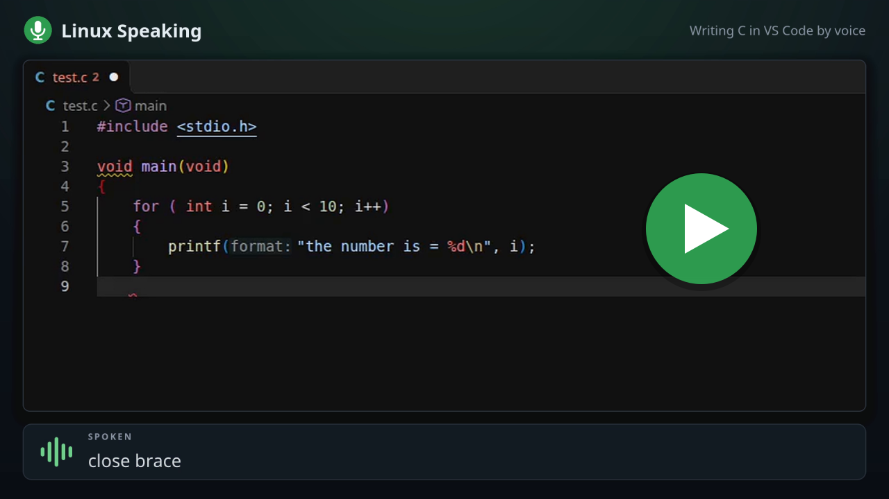

# Linux Speaking

Voice dictation for the KDE Plasma desktop that works *with* your programs instead of just
typing at them. Say **"wake up"**, talk, and your words go into LibreOffice Writer,
Thunderbird, Visual Studio Code, Kate or KWrite with the spacing and capitals already
right for where the cursor is. Edit by voice with commands like **"scratch that"**, **"select"** and
**"spell that"**.

It runs entirely on your own computer, using [Whisper](https://github.com/openai/whisper)
for speech recognition. Nothing you say is sent anywhere, and no graphics card is needed.

[](https://youtu.be/RrhKpiO7YL8)

*Watch the demo on YouTube: a small C program written in VS Code by voice (under 3 minutes).*


It was inspired by how Dragon NaturallySpeaking worked with Microsoft Word: the dictation
program knew what text was around the cursor. Linux Speaking is an independent project and
has no connection with Dragon or its makers.

## What it does

- **Wake up and go to sleep by voice.** No push-to-talk key. While asleep it listens only
  for "wake up".
- **Fits what you say to the document.** Put the cursor after a full stop and the next
  phrase starts with a space and a capital. Put it mid-sentence and it doesn't.
- **Punctuation by name.** "Comma", "full stop" or "period", "question mark", "new line",
  "new paragraph".
- **Editing commands.** Scratch that, undo that, backspace, delete last word, select a
  word or phrase, then dictate over the selection to replace it.
- **Numbered choices.** If "select fox" matches several places, a small number appears
  over each and you say which one.
- **Spell that.** A box opens and you spell a word letter by letter.
- **A tray icon** that shows whether it is off, asleep, awake or hearing you, with a
  microphone level meter that turns red when the microphone is too loud.
- **Settings** to switch any command or punctuation word on or off, and to choose the
  speech model.

| | |
|---|---|
|  | Loading, off, asleep, awake, and too loud |
|  | The level meter window |
|  | "Spell that" |
|  | Settings |

## What you need

- KDE Plasma, on Wayland or X11. It was built and tested on Kubuntu 26.04.
- A microphone. A headset works best, because an open microphone also hears your speakers.
- LibreOffice Writer, and optionally Thunderbird, Visual Studio Code, Kate or KWrite.
- About 1.5 GB of disk space, most of it the speech models.
- A reasonably recent processor. On an 8-core laptop chip a phrase takes about a second
  to appear after you stop speaking.

## Installing

```
git clone https://github.com/jontio/linux-speaking
cd linux-speaking
./install.sh
```

The installer asks for your password once, to install system packages. Everything else
goes in `~/linux-speaking` in your home folder. It then:

1. sets up the speech engine and downloads two speech models (about 650 MB),
2. installs the LibreOffice Writer extension,
3. builds the Thunderbird add-on,
4. installs the Visual Studio Code extension, if VS Code or VSCodium is installed,
5. lets Kate and KWrite be dictated into,
6. adds "Linux Speaking" to the application menu, under Utilities,
7. starts the tray icon, now and at every login.

Run `./install.sh` again at any time to update. `./uninstall.sh` removes everything except
the system packages.

### The one manual step: Thunderbird

Thunderbird doesn't let another program install an add-on, so if you use it:

1. In Thunderbird, open the menu and choose **Add-ons and Themes**.
2. Click the gear icon and choose **Install Add-on From File**.
3. Pick `~/linux-speaking/linux-speaking-thunderbird.xpi`.
4. Open a new message or reply. Compose windows that were already open won't have it.

### How well tested is the installer?

Honestly: only partly. It has been run on one Kubuntu 26.04 machine that already had the
system packages. It has **not** yet been run on a freshly installed system, and the package
lists for Fedora, Arch and openSUSE are untested. If it fails for you, please open an issue
with the output.

## On Windows: Word, Outlook and VS Code

The same engine also runs on Windows 10 and 11, where it dictates into:

- **Microsoft Word**,
- **classic Outlook**, in a message you are writing, whether in its own window or as a
  reply in the reading pane,
- **Visual Studio Code**, with everything described for it below, including the C and C++
  commands.

Word and Outlook are reached the way Dragon reached them, through Word's own automation
interface, so the spacing, capitals, "select", "scratch that" and "undo that" all work as
they do in Writer. When "select" finds several places, small yellow numbers appear over
them on screen.

To install, get Python 3.9 or newer (from the Microsoft Store or python.org), download or
clone this repository, and in PowerShell, in its folder, run:

```
powershell -ExecutionPolicy Bypass -File install.ps1
```

Nothing needs administrator rights. Everything goes in `linux-speaking` in your user
folder, a shortcut is added to the Start menu, and it starts when you sign in (set
`LS_NO_AUTOSTART=1` first if you would rather it didn't). `uninstall.ps1` removes it all.

Things to know:

- **Choose your microphone** in Settings if the level meter doesn't move when you talk.
  Windows' default recording device isn't always the one you expect.
- The tray icon may be tucked behind the little arrow by the clock. Drag it out to keep it
  in view.
- **Other programs' text boxes**, such as a chat box in a web page or Notepad, can be
  dictated into by ticking "Dictate into other programs' text boxes" in Settings. The
  words are typed in as keystrokes, with the spacing and capitals still fitted to what is
  around the cursor. Nothing is typed unless Windows says a text box that can be edited
  has the keyboard, and never into a password box. Here "new line" is Shift+Enter, and
  "press enter" is the Enter key, which in a chat box sends the message. There are no
  choice numbers and no bold or italic.
- The **new Outlook** (the one with the "New Outlook" switch) only works that way, as
  another program's text box. LibreOffice and Thunderbird have no link of their own on
  Windows yet.
- This part is new, and has been tested on one Windows 11 PC with Microsoft 365.

## Using it

1. Click into a Writer document, a Thunderbird message, a file in VS Code, or a Kate or
   KWrite window.
2. Say **"wake up"**. The tray icon turns green.
3. Talk in phrases. Text appears each time you pause.
4. Say **"go to sleep"** when you are done.

Words go to whichever supported window is in front. Hover over the tray icon to see which.
A command is a phrase said on its own, with a short pause before and after. Said in the
middle of a sentence, the same words are just typed.

Clicking the tray icon turns the microphone off or on. Right-clicking it gives you the
level meter, Settings and About.

### Commands

| Say | What happens |
|---|---|
| wake up / go to sleep | Starts and stops dictation |
| scratch that | Removes the last phrase; say it again for the one before |
| undo that | Undoes the last change |
| backspace, backspace 3 | Removes characters before the cursor |
| tab | The Tab key |
| delete last word, delete last 3 words | Removes words before the cursor |
| delete that | Removes the selection |
| select *words* | Selects those words near the cursor, with numbered choices if several match |
| select that / unselect that | Selects the last phrase / clears the selection |
| select all | Selects the whole document |
| spell that | Opens the spelling box |
| new paragraph, new line, press enter | Breaks |
| go to end of line / start of line | Moves the cursor; "move to" works in place of "go to" |
| go to end of paragraph / start of paragraph | Moves the cursor; say again to carry on to the next |
| go to top / go to bottom | Moves to the start or end of the document |
| move left 3 words, move right a word | Moves the cursor by words; "back" and "forward" work too |
| up one line, down 3 lines | Moves the cursor by lines |
| go to line 42 | Jumps to that line (VS Code, Kate) |
| select line, delete line, delete 3 lines | Selects or removes whole lines |
| duplicate line, indent, outdent, comment line | Line editing in VS Code |
| cap that, all caps that, no caps that | Changes the case of the selection or last phrase |
| bold that, italicize that, underline that | Formats the selection or last phrase (not in Kate; Markdown only in VS Code) |

Punctuation words, said while dictating: comma, full stop, period (off by default),
question mark, exclamation mark, colon, semicolon, hyphen, ellipsis, open and close
bracket, open and close quote. Say "literal comma" to type the word itself.

In the spelling box, say letters one at a time or several together. Letter names and the
radio alphabet both work. "Capital J" gives a capital. "Space", "hyphen", "double L",
"backspace" and "start again" do what they say. "Done" puts the word in, "cancel" doesn't.

### Differences between programs

- **Kate and KWrite** are plain text, so there is no bold or italic, "new paragraph" leaves
  a blank line, and "select" takes the nearest match without showing numbers. Start them
  from the application menu, not a terminal, or dictation can't see them.
- **Thunderbird** works in the message body only, not the address or subject boxes.
- **Visual Studio Code** is treated as plain text, with extras for Markdown files. After a
  heading or list marker the next words start with a capital. "New line" inside a list
  starts the next item, and on an empty item ends the list. "Bold that" and "italicize
  that" wrap the words in `**` and `*`. Words go into the file you have open, even if the
  keyboard is in the terminal or chat panel. A VS Code installed as a Flatpak can't be
  reached, because of its sandbox.

## Other programs

For programs without their own link, there is a setting, off by default: **Dictate into
other programs' text boxes**. With it on, when none of the programs above is in front,
your words go into whichever text box has the keyboard, with the same spacing, capitals
and commands as in Kate. It works with Qt and GTK programs. It uses the desktop's
accessibility interface, the one screen readers use, and the setting switches that on for
your session (and back off again when you untick it).

It does not work in terminals, in Electron programs such as Slack, or in Firefox. Password
boxes are always refused. A one-line box turns "new line" into a space. As in Kate,
"select" takes the nearest match.

## Programming in C and C++ with VS Code

In a `.c`, `.cpp`, `.h` or `.hpp` file open in VS Code, dictation switches to rules made
for source code. Symbols are spoken, everything else is lower case, and spacing follows
the usual C style. Saying

> int line count equals zero semicolon

types `int line_count = 0;`, and

> for open bracket int i equals zero semicolon i less than ten semicolon i plus plus
> close bracket open brace

types `for (int i = 0; i < 10; i++) {`. "New line" keeps the indentation, goes a step
deeper after `{`, and a "close brace" on its own line steps back out.

It pays attention to what you are doing:

- **Names already in the file are recognised.** If the file has `bufferSize`, saying
  "buffer size" types `bufferSize`. If it has `buffer_size`, that is what you get.
- **New names follow the file's style.** Several plain words in a row become one name,
  joined `like_this` or `likeThis` to match the rest of the file. Say "space" to keep two
  names apart: "widget space w" types `widget w`.
- **It knows where the cursor is.** Inside quotes, words keep their spaces. After `//`,
  or when you say "comment", ordinary prose dictation takes over. After `#include`,
  angle brackets hug the file name.
- **Operators are judged by what is around them.** "Minus" is a sign after `=` or
  `return` and a subtraction between two values. "Star" after a type is a pointer mark.
  An opening bracket hugs a function name but not `if` or `while`.

| Say | Types |
|---|---|
| open bracket, close bracket (or "paren") | `(` `)` |
| open brace, close brace | `{` `}` |
| open square, close square | `[` `]` |
| open angle, close angle, less than, greater than | `<` `>` |
| semicolon, comma, colon, dot, hash | `;` `,` `:` `.` `#` |
| equals, double equals, not equals | `=` `==` `!=` |
| plus, minus, times or star, slash, percent | `+` `-` `*` `/` `%` |
| plus plus, minus minus, plus equals, minus equals | `++` `--` `+=` `-=` |
| and and, or or, bang | `&&` `\|\|` `!` |
| ampersand, pipe, caret, tilde | `&` `\|` `^` `~` |
| arrow, double colon | `->` `::` |
| shift left, shift right | `<<` `>>` |
| quote, single quote, backslash, underscore | `"` `'` `\` `_` |
| comment | `//`, and the rest of the phrase as prose |
| space | a space between two names |
| camel case, pascal case, snake case, constant | the next name `likeThis`, `LikeThis`, `like_this`, `LIKE_THIS` |
| capital | a capital on the next word |
| literal | the next word as itself: "literal comma" types `comma` |

Number words become digits, and common names said as several words are known: "print f",
"size of", "null pointer", "u int 8 t", "c out", "end l". The usual commands still work:
scratch that, undo that, backspace, select, the cursor moves and spell that.

### Better guesses with a C/C++ language server

If VS Code has a C/C++ extension that understands your code, such as
[clangd](https://marketplace.visualstudio.com/items?itemName=llvm-vs-code-extensions.vscode-clangd),
dictation uses what it knows. Before each phrase it asks what is in scope at the cursor:
which variables, functions and types exist there. Then:

- **A misheard name becomes the real one.** "Line counts" types `lineCount` if that is a
  variable here and nothing called `lineCounts` is. "Pointer" types `ptr`.
- **A name you are declaring is left alone.** After `int`, `char *`, `struct` or a type's
  name, what you say is new, so it is never changed to something that already exists.
- **Keywords and numbers are judged by position.** At the start of a statement "four" is
  `for`. Where a value is expected, "to" is `2` and "won" is `1`, unless a variable of
  that name exists.
- **Brackets said unclearly are understood.** "Open racket" is `(`.
- **The speech model is told what to listen for:** the names in scope, nearest first.

Without such an extension none of this is guessed at: names are taken from the words in
the file, as described above. To add clangd on Ubuntu: `sudo apt install clangd`, then
install the clangd extension in VS Code.

This is one setting, "VS Code C/C++ coding commands", in the Settings window. With it
off, C and C++ files are treated as plain text. It is a first version: speech models are
trained on prose, so expect to correct it more often than when writing English.

## Settings and speech models

The Settings window lets you untick any command or punctuation word. Unticked, the words
are typed as ordinary text.

It also lets you choose the speech model. The installer provides Base and Small. Small is
the default. Bigger models make fewer mistakes but take longer after each phrase. Any
[faster-whisper](https://github.com/SYSTRAN/faster-whisper) model placed in
`~/linux-speaking/models/` appears in the list.

## If something isn't working

- **"Wake up" is ignored.** Open the level meter from the tray icon and speak. The bar
  should fill at least half way. If it barely moves, the microphone is too quiet or the
  wrong one is selected in your sound settings. If it turns red, it is too loud.
- **Words don't appear.** Hover over the tray icon. It says which program it is typing
  into, or that nothing suitable is in front.
- **Nothing works in Writer after an update.** If LibreOffice was open during the update,
  the new extension is waiting. Close LibreOffice for ten seconds and reopen it.
- **Kate isn't picked up.** Close Kate and start it again from the application menu.
- **VS Code isn't picked up.** Restart VS Code, and check that "Linux Speaking" is in its
  Extensions list. If not: `code --install-extension ~/linux-speaking/linux-speaking.vsix`.
- **Text deletes itself in VS Code, or another program beeps continuously.** A key is stuck
  held down in the desktop's X11 layer. This can happen after using a remote or on-screen
  keyboard, such as KDE Connect's. Press that key once on a real keyboard, usually
  Backspace, or log out and back in.
- **A log** of what the engine is doing: `journalctl --user -u linux-speaking -f`.
  Dictated text is never written to the log, only its length.
- **To see why "wake up" was missed,** turn on extra logging with
  `systemctl --user edit linux-speaking`, add the two lines `[Service]` and
  `Environment=LS_LOG_PHRASES=1`, and restart the service. The log then shows the length
  and loudness of each phrase heard while asleep, and the text of phrases of three words
  or fewer. It is off by default.

## How it works

A speech engine listens to the microphone, cuts what you say into phrases at each pause,
and runs Whisper on each one. It decides whether a phrase is a command or dictation, reads
the text around the cursor from the program in front, fits the words to it, and asks that
program to insert them. Each program is reached a different way: a LibreOffice extension,
a Thunderbird add-on, a VS Code extension, and the desktop's accessibility interface for
Kate and KWrite.

[docs/DESIGN.md](docs/DESIGN.md) has the details, including how to add another program.

## Developing

The rule tests need only Python 3.10 or newer:

```
python3 -m unittest discover -s tests -t .
```

The others drive real programs and are described in [docs/DESIGN.md](docs/DESIGN.md).
See [CONTRIBUTING.md](CONTRIBUTING.md) for how to report a problem or send a change, and
[CHANGELOG.md](CHANGELOG.md) for what has changed.

## Licence

Linux Speaking is free software under the
[GNU General Public License, version 3](LICENSE) or (at your option) any later version.
It comes with no warranty.

It builds on OpenAI's Whisper, [faster-whisper](https://github.com/SYSTRAN/faster-whisper),
[CTranslate2](https://github.com/OpenNMT/CTranslate2) and
[PyQt6](https://www.riverbankcomputing.com/software/pyqt/). The speech models are
downloaded from Hugging Face when you install and are not part of this repository.
