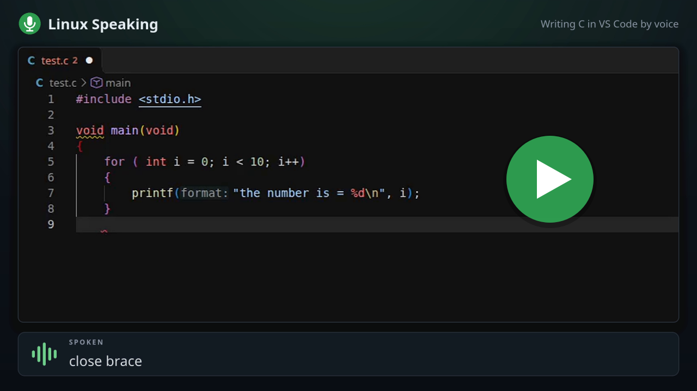
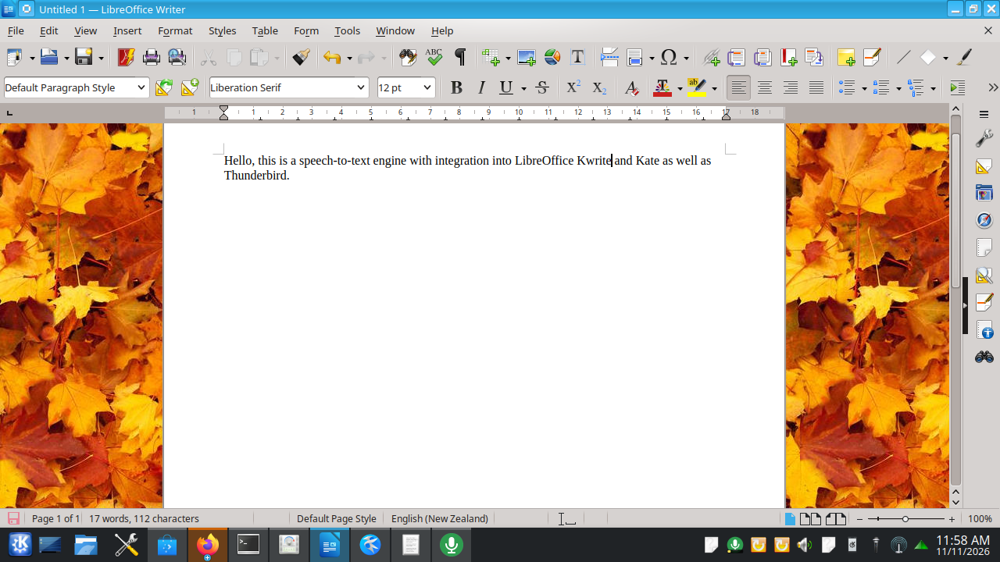
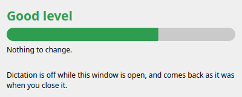
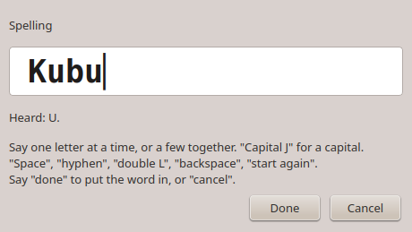
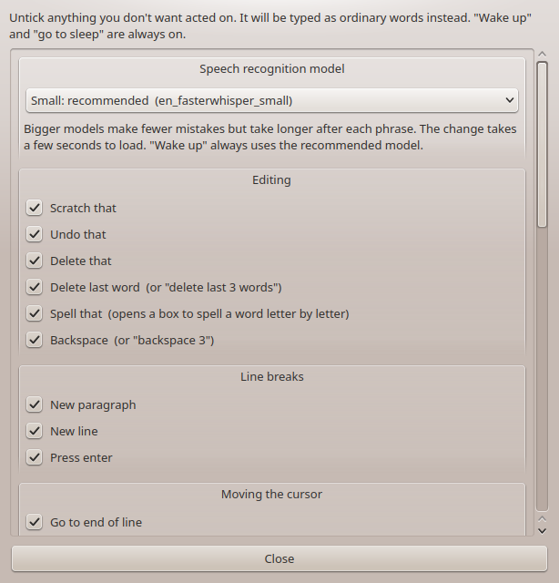

# Linux Speaking

Voice dictation for the KDE Plasma desktop that works *with* your programs instead of just
typing at them. Say **"wake up"**, talk, and your words go into LibreOffice Writer,
Thunderbird, Visual Studio Code, Kate or KWrite with the spacing and capitals already
right for where the cursor is. Edit by voice with commands like **"scratch that"**, **"select"** and
**"spell that"**.

It runs entirely on your own computer, using [Whisper](https://github.com/openai/whisper)
for speech recognition. Nothing you say is sent anywhere, and no graphics card is needed.
(If you have a second, faster computer, you can choose to have it do the recognising.)

[](https://youtu.be/RrhKpiO7YL8)

*Watch the demo on YouTube: a small C program written in VS Code by voice (under 3 minutes).*



It was inspired by how Dragon NaturallySpeaking worked with Microsoft Word: the dictation
program knew what text was around the cursor. Linux Speaking is an independent project and
has no connection with Dragon or its makers.

## What it does

- **Wake up and go to sleep by voice.** No push-to-talk key. While asleep it listens only
  for "wake up". A setting lets "wake" and "sleep" by themselves do the same.
- **Fits what you say to the document.** Put the cursor after a full stop and the next
  phrase starts with a space and a capital. Put it mid-sentence and it doesn't.
- **Punctuation by name.** "Comma", "full stop" or "period", "question mark", "new line",
  "new paragraph".
- **Editing commands.** Scratch that, undo that, backspace, delete last word, select a
  word or phrase, then dictate over the selection to replace it.
- **Numbered choices.** If "select fox" matches several places, a small number appears
  over each and you say which one.
- **Spell that.** A box opens and you spell a word letter by letter.
- **A tray icon** that shows whether it is off, asleep, awake or hearing you, with a
  microphone level meter that turns red when the microphone is too loud.
- **Settings** to switch any command or punctuation word on or off, and to choose the
  speech model.

| | |
|---|---|
|  | Loading, off, asleep, awake, and too loud |
|  | The level meter window |
|  | "Spell that" |
|  | Settings |

## What you need

- KDE Plasma, on Wayland or X11. It was built and tested on Kubuntu 26.04.
- A microphone. A headset works best, because an open microphone also hears your speakers.
- LibreOffice Writer, and optionally Thunderbird, Visual Studio Code, Kate or KWrite.
- About 1.5 GB of disk space, most of it the speech models.
- A reasonably recent processor. On an 8-core laptop chip a phrase takes about a second
  to appear after you stop speaking.

## Installing

```
git clone https://github.com/jontio/linux-speaking
cd linux-speaking
./install.sh
```

The installer asks for your password once, to install system packages. Everything else
goes in `~/linux-speaking` in your home folder. It then:

1. sets up the speech engine and downloads two speech models (about 650 MB),
2. installs the LibreOffice Writer extension,
3. builds the Thunderbird add-on,
4. installs the Visual Studio Code extension, if VS Code or VSCodium is installed,
5. lets Kate and KWrite be dictated into,
6. adds "Linux Speaking" to the application menu, under Utilities,
7. starts the tray icon, now and at every login.

Run `./install.sh` again at any time to update. `./uninstall.sh` removes everything except
the system packages.

### The one manual step: Thunderbird

Thunderbird doesn't let another program install an add-on, so if you use it:

1. In Thunderbird, open the menu and choose **Add-ons and Themes**.
2. Click the gear icon and choose **Install Add-on From File**.
3. Pick `~/linux-speaking/linux-speaking-thunderbird.xpi`.
4. Open a new message or reply. Compose windows that were already open won't have it.

### How well tested is the installer?

Honestly: only partly. It has been run on one Kubuntu 26.04 machine that already had the
system packages. It has **not** yet been run on a freshly installed system, and the package
lists for Fedora, Arch and openSUSE are untested. If it fails for you, please open an issue
with the output.

## On Windows: Word, Outlook and VS Code

The same engine also runs on Windows 10 and 11, where it dictates into:

- **Microsoft Word**,
- **classic Outlook**, in a message you are writing, whether in its own window or as a
  reply in the reading pane,
- **Visual Studio Code**, with everything described for it below, including the C and C++
  commands.

Word and Outlook are reached the way Dragon reached them, through Word's own automation
interface, so the spacing, capitals, "select", "scratch that" and "undo that" all work as
they do in Writer. When "select" finds several places, small yellow numbers appear over
them on screen.

To install, get Python 3.9 or newer (from the Microsoft Store or python.org), download or
clone this repository, and in PowerShell, in its folder, run:

```
powershell -ExecutionPolicy Bypass -File install.ps1
```

Nothing needs administrator rights. Everything goes in `linux-speaking` in your user
folder, a shortcut is added to the Start menu, and it starts when you sign in (set
`LS_NO_AUTOSTART=1` first if you would rather it didn't). `uninstall.ps1` removes it all.

Things to know:

- **The number pad's + key** switches dictation between off and awake, whichever program
  is in front. While it does, the key no longer types a plus; untick it in Settings to get
  the plus back.
- **Choose your microphone** in Settings if the level meter doesn't move when you talk.
  Windows' default recording device isn't always the one you expect.
- The tray icon may be tucked behind the little arrow by the clock. Drag it out to keep it
  in view.
- **The app's windows and the tray icon's menu can have the look of Windows 10, Windows 7
  or Windows XP**: the title bar, the window's colour, its buttons, tick boxes and scroll
  bars. Choose under Appearance, at the foot of Settings, and every window follows. It is
  drawn by the app itself; only the box for choosing a file stays Windows' own.
- **Other programs' text boxes**, such as a chat box in a web page or Notepad, can be
  dictated into by ticking "Dictate into other programs' text boxes" in Settings. The
  words are typed in as keystrokes, with the spacing and capitals still fitted to what is
  around the cursor. Nothing is typed unless Windows says a text box that can be edited
  has the keyboard, and never into a password box. Here "new line" is Shift+Enter, and
  "press enter" is the Enter key, which in a chat box sends the message. There are no
  choice numbers and no bold or italic.
- The **new Outlook** (the one with the "New Outlook" switch) only works that way, as
  another program's text box. LibreOffice and Thunderbird have no link of their own on
  Windows yet.
- This part is new, and has been tested on one Windows 11 PC with Microsoft 365.

## Using it

1. Click into a Writer document, a Thunderbird message, a file in VS Code, or a Kate or
   KWrite window.
2. Say **"wake up"**. The tray icon turns green.
3. Talk in phrases. Text appears each time you pause.
4. Say **"go to sleep"** when you are done.

Words go to whichever supported window is in front. Hover over the tray icon to see which.
A command is a phrase said on its own, with a short pause before and after. Said in the
middle of a sentence, the same words are just typed.

Clicking the tray icon turns the microphone off, or back on and awake, ready for you to
talk. Right-clicking it gives you the level meter, Settings and About.

The level meter is a small window for trying your microphone. It opens the microphone by
itself and shows how loud your voice is as you speak, with the same bar as the reading
window: grey and blue for too quiet, green for a good level, yellow, orange and red as
the microphone runs out of room. Above the bar each phrase is judged in words, with what
to do about it. Dictation is off while the window is open, so nothing you say to it is
typed, and comes back as it was when you close or minimise it. Asking for dictation from
the tray icon closes it for you.

### Commands

| Say | What happens |
|---|---|
| wake up / go to sleep | Starts and stops dictation |
| wake / sleep | The same, in one word each, if **Wake, sleep** is ticked in Settings. It is off to begin with: a lone "sleep" can then no longer be dictated, and one word is a little easier to set off by accident than two. "Wake up" and "go to sleep" go on working |
| scratch that | Removes the last phrase; say it again for the one before |
| undo that | Undoes the last change |
| backspace, backspace 3 | Removes characters before the cursor |
| tab | The Tab key |
| space, space 3 | The space bar, once or several times |
| enter | The Enter key, the same as "press enter". Off until ticked in Settings |
| delete last word, delete last 3 words | Removes words before the cursor |
| delete that | Removes the selection |
| select *words* | Selects those words near the cursor, with numbered choices if several match. Say a number, or "cancel". Words that sound the same are found too: "select two" finds "2", "to" and "too" |
| select that, correct that / unselect that | Highlights the last phrase, so what you say next replaces it / clears the selection |
| select all | Selects the whole document |
| spell that | Opens the spelling box |
| new paragraph, new line, press enter | Breaks |
| go to end of line / start of line | Moves the cursor; "move to" works in place of "go to" |
| go to end of paragraph / start of paragraph | Moves the cursor; say again to carry on to the next |
| go to top / go to bottom | Moves to the start or end of the document |
| move left 3 words, move right a word | Moves the cursor by words; "back" and "forward" work too |
| up one line, down 3 lines | Moves the cursor by lines |
| go to line 42 | Jumps to that line (VS Code, Kate) |
| select line, delete line, delete 3 lines | Selects or removes whole lines |
| duplicate line, indent, outdent, comment line | Line editing in VS Code |
| cap that, all caps that, no caps that | Changes the case of the selection or last phrase |
| bold that, italicize that, underline that | Formats the selection or last phrase (not in Kate; Markdown only in VS Code) |

Punctuation words, said while dictating: comma, full stop, period (off by default),
question mark, exclamation mark, colon, semicolon, hyphen, ellipsis, open and close
bracket, open and close quote. Say "literal comma" to type the word itself.

The recogniser adds commas of its own inside a phrase, and they are kept, with one
exception: the comma it puts after a greeting, as in "Hello, Bob", is left out, giving
"Hello Bob". "Hello, how are you" and "Cheers, Bob" keep theirs. Untick **No comma after
Hello or Hi** in Settings to have it back.

Only punctuation you say is typed at the end of a phrase: the recogniser's own full stop
or question mark there is dropped, because it adds one after every phrase. If you pause
before saying "question mark", the recogniser sometimes writes the sign and not the words,
which would then be dropped too. So when a phrase ends with a pause and a few last words,
and no punctuation word came out, those last words are listened to once more by
themselves. That takes well under a second.

In the spelling box, say letters one at a time or several together. Letter names and the
radio alphabet both work. "Capital J" gives a capital. "Space", "hyphen", "double L",
"backspace" and "start again" do what they say. "Done" puts the word in, "cancel" doesn't.

### Differences between programs

- **Kate and KWrite** are plain text, so there is no bold or italic, "new paragraph" leaves
  a blank line, and "select" takes the nearest match without showing numbers. Start them
  from the application menu, not a terminal, or dictation can't see them.
- **Thunderbird** works in the message body only, not the address or subject boxes.
- **Visual Studio Code** is treated as plain text, with extras for Markdown files. After a
  heading or list marker the next words start with a capital. "New line" inside a list
  starts the next item, and on an empty item ends the list. "Bold that" and "italicize
  that" wrap the words in `**` and `*`. Words go into the file you have open, even if the
  keyboard is in the terminal or chat panel. A VS Code installed as a Flatpak can't be
  reached, because of its sandbox.

## Other programs

For programs without their own link, there is a setting, off by default: **Dictate into
other programs' text boxes**. With it on, when none of the programs above is in front,
your words go into whichever text box has the keyboard, with the same spacing, capitals
and commands as in Kate. It works with Qt and GTK programs. It uses the desktop's
accessibility interface, the one screen readers use, and the setting switches that on for
your session (and back off again when you untick it).

Password boxes are always refused. A one-line box turns "new line" into a space. As in
Kate, "select" takes the nearest match. It does not work in terminal programs such as
Konsole, or in Firefox.

### VS Code's panels, and other programs built from a web browser

The same setting covers the text boxes that Qt and GTK don't draw: the chat box of an
assistant in VS Code, VS Code's terminal, and the boxes of programs built from a web
browser. (Files open in VS Code's editor go through its own extension, as before.)

These programs let their text boxes be read through the accessibility interface, but not
written. So Linux Speaking reads what is around the cursor there, and types the words as
key presses. The grey hint in an empty box ("Type a message") is not taken for text: the
first words get their capital and no space in front.

Two things have to be set up, once each:

1. **The program has to describe its text boxes**, which it only does if asked when it
   starts. For VS Code that is one line in `~/.vscode/argv.json`:

   ```json
   "force-renderer-accessibility": true
   ```

   The installer adds it if VS Code is there (in VS Code: **Preferences: Configure Runtime
   Arguments** opens the file). Restart VS Code afterwards. Nothing else about VS Code
   changes, and it goes on updating as usual. If VS Code asks whether you are using a
   screen reader, say no. Chrome and its relatives take the same switch on their command
   line, `--force-renderer-accessibility`.

2. **The desktop has to allow Linux Speaking to press keys.** On a Wayland desktop no
   program may type into another without leave. The first time you dictate into such a
   box, the desktop asks whether Linux Speaking may control the keyboard. Allow it, and
   let it be remembered. Your first phrase waits for the answer and is then typed. Only
   the keyboard is asked for: nothing is seen of the screen. To take the leave back,
   delete `~/.local/state/linux-speaking/keys-token` and the desktop will ask again.

What to know:

- It has been tried with VS Code on KDE Plasma (Wayland). Other programs built from a
  browser should behave the same once started with the switch, but haven't been tried.
- A character the keyboard hasn't got is typed plain: "café" as "cafe", curly quotes as
  straight ones, a long dash as a hyphen.
- In a chat box "new line" is Shift+Enter, and "press enter" sends the message, as the
  Enter key does there.
- "Scratch that" takes back the last phrase only while it is still what is just before
  the cursor.

## Programming in C and C++ with VS Code

In a `.c`, `.cpp`, `.h` or `.hpp` file open in VS Code, dictation switches to rules made
for source code. Symbols are spoken, everything else is lower case, and spacing follows
the usual C style. Saying

> int line count equals zero semicolon

types `int line_count = 0;`, and

> for open bracket int i equals zero semicolon i less than ten semicolon i plus plus
> close bracket open brace

types `for (int i = 0; i < 10; i++) {`. "New line" keeps the indentation, goes a step
deeper after `{`, and a "close brace" on its own line steps back out.

It pays attention to what you are doing:

- **Names already in the file are recognised.** If the file has `bufferSize`, saying
  "buffer size" types `bufferSize`. If it has `buffer_size`, that is what you get.
- **New names follow the file's style.** Several plain words in a row become one name,
  joined `like_this` or `likeThis` to match the rest of the file. Say "space" to keep two
  names apart: "widget space w" types `widget w`.
- **It knows where the cursor is.** Inside quotes, words keep their spaces. After `//`,
  or when you say "comment", ordinary prose dictation takes over. After `#include`,
  angle brackets hug the file name.
- **Operators are judged by what is around them.** "Minus" is a sign after `=` or
  `return` and a subtraction between two values. "Star" after a type is a pointer mark.
  An opening bracket hugs a function name but not `if` or `while`.

| Say | Types |
|---|---|
| open bracket, close bracket (or "paren") | `(` `)` |
| open brace, close brace | `{` `}` |
| open square, close square | `[` `]` |
| open angle, close angle, less than, greater than | `<` `>` |
| semicolon, comma, colon, dot, hash | `;` `,` `:` `.` `#` |
| equals, double equals, not equals | `=` `==` `!=` |
| plus, minus, times or star, slash, percent | `+` `-` `*` `/` `%` |
| plus plus, minus minus, plus equals, minus equals | `++` `--` `+=` `-=` |
| and and, or or, bang | `&&` `\|\|` `!` |
| ampersand, pipe, caret, tilde | `&` `\|` `^` `~` |
| arrow, double colon | `->` `::` |
| shift left, shift right | `<<` `>>` |
| quote, single quote, backslash, underscore | `"` `'` `\` `_` |
| comment | `//`, and the rest of the phrase as prose |
| space | a space between two names |
| camel case, pascal case, snake case, constant | the next name `likeThis`, `LikeThis`, `like_this`, `LIKE_THIS` |
| capital | a capital on the next word |
| literal | the next word as itself: "literal comma" types `comma` |

Number words become digits, and common names said as several words are known: "print f",
"size of", "null pointer", "u int 8 t", "c out", "end l". The usual commands still work:
scratch that, undo that, backspace, select, the cursor moves and spell that.

### Better guesses with a C/C++ language server

If VS Code has a C/C++ extension that understands your code, such as
[clangd](https://marketplace.visualstudio.com/items?itemName=llvm-vs-code-extensions.vscode-clangd),
dictation uses what it knows. Before each phrase it asks what is in scope at the cursor:
which variables, functions and types exist there. Then:

- **A misheard name becomes the real one.** "Line counts" types `lineCount` if that is a
  variable here and nothing called `lineCounts` is. "Pointer" types `ptr`.
- **A name you are declaring is left alone.** After `int`, `char *`, `struct` or a type's
  name, what you say is new, so it is never changed to something that already exists.
- **Keywords and numbers are judged by position.** At the start of a statement "four" is
  `for`. Where a value is expected, "to" is `2` and "won" is `1`, unless a variable of
  that name exists.
- **Brackets said unclearly are understood.** "Open racket" is `(`.
- **The speech model is told what to listen for:** the names in scope, nearest first.

Without such an extension none of this is guessed at: names are taken from the words in
the file, as described above. To add clangd on Ubuntu: `sudo apt install clangd`, then
install the clangd extension in VS Code.

This is one setting, "VS Code C/C++ coding commands", in the Settings window. With it
off, C and C++ files are treated as plain text. It is a first version: speech models are
trained on prose, so expect to correct it more often than when writing English.

## Settings and speech models

The Settings window lets you untick any command or punctuation word. Unticked, the words
are typed as ordinary text.

It also lets you choose the speech model. The installer provides Base and Small. Small is
the default. Bigger models make fewer mistakes but take longer after each phrase.

Nearly every setting is about what is done with the words, and works the same whichever
model wrote them, on this computer or another: the commands, the punctuation words,
"wake" and "sleep", your own words. A few are about the listening itself, and a tick box
that would do nothing with the model in use is greyed, and says why when the mouse rests
on it. Leaving out sounds that aren't speech is for Parakeet models. Second opinions want
two more models installed to give them. Quicker recognition is for Whisper; with a
Parakeet model it only quickens what Whisper still hears, which is spelling, source code
and second opinions.

**Quicker recognition** is a tick box under "Speed". Whisper works through half a minute
of sound however short the phrase, and that is most of the wait. Ticked, it is given only
as much as the phrase needs, which is three or four times quicker with the same words. Now
and then Whisper loses its place when treated this way and writes a phrase over and over;
that is spotted, and the phrase is done again the usual way.

**Parakeet** is a different recogniser that can be chosen like a model. It is quicker
again and about as accurate as Whisper's Medium, and English only. It can't be shown the
text before the cursor, and it finds your own words by their sound once it has written
them down, not by being told to expect them. "Wake up", spelling and source code are
still done by Whisper. It is NVIDIA's Parakeet TDT 0.6b v2, licensed CC BY 4.0, run by
[sherpa-onnx](https://github.com/k2-fsa/sherpa-onnx).

Parakeet has one bad habit: given a short noise by itself, a rustle of clothing or a key
press, it will now and then write a word for it, nearly always "yeah", "uh" or "okay". So
each phrase it writes words for is also put to a voice detector (Silero's, the one
Whisper already uses), and a phrase with nothing like speech in it is left out, as is one
of those few words with no clear speech behind it. Tried on some 750 recorded noises of
things, such as typing, mouse clicks, a ticking clock and dripping water, Parakeet
Unified wrote words for 77 of them and all but 2 were left out. It took nothing from 51
read sentences, and one of 364 single-word commands spoken by many people. A cough, a
sneeze or a laugh is made with the voice, and about half of those still get through. A
real "yeah" is kept. It adds a few thousandths of a second to a phrase. **Leave out
sounds that aren't speech** in Settings switches it off.

The models window lists Parakeet in four forms. **Parakeet Unified** is NVIDIA's newer
Parakeet Unified 0.6b, under the NVIDIA Open Model License; by NVIDIA's own figures it
gets slightly fewer words wrong. Either of the two can also be had **at full precision**:
the same recogniser with its numbers as they were trained, where the usual form rounds
each one to eight bits to make it a quarter of the size. That is a 2.5 GB download, takes
longer to start, and is a little slower for each phrase. Whether any of them hears you
better than the usual Parakeet is for the voice test to say.

**Test them on my voice** finds out which model suits you. The window has a tab for each
step. On the first you read a passage aloud once. Half of it is ordinary sentences, which
a good recogniser gets right every time. The other half is made of words one vowel away
from another word ("pen" and "pin", "better" and "beta"), which is where recognisers
differ and where an accent shows. On the second tab you tick the recognisers to try:
every one installed, to begin with. Each then hears that one recording, cut into phrases
at your pauses as dictation would cut it, and the third tab shows how many words each got
wrong and how long it took for a phrase, with the best trade-off pointed out. A word that
every recogniser wrote the same wrong way was most likely read differently from the text,
so it is listed but not counted against any of them. Click a row to see the words it got
wrong. The recording is kept on your computer, so the test can be run again after
anything changes.

The results also count **near misses**: words a recogniser got right, but was less than
90% sure of as it wrote them. Two recognisers that both get every word right can still
differ in how much they had in hand, and a near miss today is a wrong word on a worse
day. Click a row to see which words they were. The first word of each phrase is left out,
since the doubt there is mostly whether to give it a capital. Compare near misses between
forms of the same recogniser, such as Parakeet with its full-precision form, or one
Whisper model with another: different recognisers don't measure their own sureness alike,
and one can be sure and wrong. Finding this out changes nothing about how a recogniser
listens, and the moment it takes is left out of the time for a phrase. Several
recognisers working together show a dash.

With Parakeet, Small and Medium all installed, the list also offers the three working
together: **Parakeet, checked by Small and Medium**. Each of them gets some words wrong
that the others get right. Parakeet and Small both hear the phrase; where they wrote the
same, that stands, and where they differ Medium is asked and the two that agree win.

To dictate that way, tick **Second opinions** in Settings. It is a trial. Each phrase is
heard by your chosen model first, then by Small, and by Medium only if those two differ,
so most phrases take a little longer and some a good deal longer. The others listen
wherever the first did: on the other computer if recognition is done there and it has
the models, else on this one. Punctuation you say aloud and your own words are never
changed by a second opinion. Spelling, source code and "wake up" are left as they were.

**Read aloud for training** collects recordings of your voice with the words that go with
each. It is the first half of a trial, retraining Parakeet to one person's voice; the
second half, the retraining, is **Train on my voice**, below. One sentence is shown at a
time. Read it aloud,
the way you dictate, and it moves on by itself. At each pause the recogniser you dictate
with hears the sentence so far, and when it has heard it to the end the sound is kept and
the next sentence comes up: with Parakeet, about a second after you stop. A pause in the
middle of a sentence is waited out. Up to a quarter of the words may be heard wrong and
the sentence still counts as read, since the words a recogniser gets wrong are the ones
worth teaching it; something that isn't the sentence at all is not kept, and you are
asked to read it again. The space bar moves on at once, keeping what you read, or passes
over a sentence you haven't read. Untick **Move on by itself** to work that way
throughout. If you stumble, start the sentence again or go back one. A bar under the
sentence shows how loud you are as you speak, with no steps in it: its length is the
loudness and its colour the verdict, from grey and blue for too quiet for the room,
through green for a good level, to yellow, orange and red as the microphone runs out of
room. Beside it the sentence as a whole is judged in words. One button starts, pauses and
carries on. Pause for a rest whenever you like: the microphone is closed, dictation comes
back as it was, and the space bar carries on from the same sentence. It pauses by itself
if nothing is read for a minute, and then brings dictation back asleep, so that it
doesn't write down what it overhears. When you have had enough, close the window: the
next sitting, today or another day, begins at the first sentence not yet read. Three
hundred sentences come with it, about half an hour's reading, a fifth of them built from
words a vowel away from another word. When you have read them all, **Read them all
again** starts over from the top, for more of your voice, or your voice in another room:
what you read before is kept, and the new readings beside it. You can read a plain text file of your own instead,
such as something you wrote, which has your own words in it. Its sentences with figures
or unusual marks in them are left out, because a recogniser may write those another way.
Each sentence is kept as a sound file with the silence trimmed off, in a folder for the
day, beside a list of what was read (`said.txt`). The folders are in
`~/.local/state/linux-speaking/training/`, or on Windows in `state\training` in the
install folder; the window has a button that opens it. The recordings stay on your
computer, and dictation is switched off while you read.

**Train on my voice** does the retraining, on the computer's own processor. It is a
trial too: whether it makes a model better for you is what it is there to find out. It
asks three things: the folder of sentences (the reading window's own to begin with),
the model to start from (Parakeet Unified or Parakeet v2), and a name for the result. One sentence in
six is kept out of the training, and when it is over the model as it came and the
retrained one both hear those: the window says how many words each got wrong, and how
many it got right without being sure of. The new model is then among the speech models
under its name, to be chosen for dictation or tried in the voice test beside the others.

It learns from single words as well as from the sentences. A recogniser learns only from
what it gets wrong or is unsure of, and in a sentence the other words settle what a word
is: trained on sentences alone, a model heard them a little better and single words no
better at all. So the words of each sentence are cut out and learned from one by one,
where there is nothing but the voice to go by. On single words cut from sentences kept
out of the training, one pass took Parakeet Unified from 56 in a hundred right to 80,
with the sentences heard as well as before. The cutting is done with Parakeet v2, which
says closely when each word was spoken, so it wants that model installed whichever one
is being retrained; if it is missing the window offers to fetch it first, and without it
only the sentences are learned from. (Parakeet Unified hears better, but writes each word a third
of a second or so after it was said, and unevenly; Whisper's word times are as loose.) The window's result
counts those single words too.

Half an hour of reading takes about seven minutes a pass on an eight-core processor,
half an hour or so in all, and about 14 GB of memory. So the work runs by itself, at low priority: close the window
or the app and it goes on, and dictation goes on working, a little slower. The window
shows how far it has come whenever it is opened, and a notice says when it has ended. It
can be stopped, and carried on later from the last pass that was finished. It goes over
the sentences up to ten times, and stops sooner when the sentences it keeps aside to
judge by stop being heard better: a first run of ten passes was at its best after two.

The training tools are no part of the ordinary install: they are a Python of their own
with PyTorch and NeMo, about 2 GB. The first time, the window offers to install them,
with one button, on Linux and on Windows; the install goes on if the window is closed.
(It runs `scripts/install-training.sh` or `scripts/install-training.ps1`, which can be
run by hand too.) They go into a folder of their own, `training`, beside the app, and
removing that folder removes them. The first run also fetches the model's training
checkpoint, 2.5 GB. A run wants about 14 GB of free memory, and the window says so if
there isn't that much. On Windows the tools install and every step of a run has been
tried, in a reduced form, on a four-core laptop without the free memory for a real one;
a full run there has not been timed, and is reckoned at three hours or so.

**Install or remove models** under the chooser lists the others, from Tiny (78 MB) to
Large (3.1 GB), with a button to download or remove each. A download is checked before
the model is offered, carries on if you close the window, and picks up where it stopped
if the connection drops. The model in use and the one that listens for "wake up" can't be
removed. Models come from [Hugging Face](https://huggingface.co); only the download
itself goes over the internet.

Any other [faster-whisper](https://github.com/SYSTRAN/faster-whisper) model placed in
`~/linux-speaking/models/` appears in the list too.

### Using another computer for the recognition

Recognising speech is the slow part, and a faster computer on the same network can do it.
Both computers need Linux Speaking installed.

1. On the faster computer, open Settings and tick **Let other computers use this one for
   speech recognition**. It shows an address and a key.
2. On the other one, tick **Use another computer for speech recognition**, type in that
   address and key, and press **Connect**. Choose which of the faster computer's models to
   use, or leave it to pick the same one as here.

From then on each phrase is sent there and the words come back. If that computer is off or
out of reach, this one does the work itself and tries the other again after a short while.
The tray icon's tooltip says where the recognising is being done.

Things to know:

- **"Wake up" is still listened for on this computer**, so nothing is sent while dictation
  is asleep. A tick box sends that too, which wakes it sooner on a slow computer.
- **Only computers with the key can use the recogniser.** The key itself is never sent.
- **The sound and the words are not encrypted on the way.** Use it on your own network, or
  over a VPN that encrypts, and not across the open internet.
- The faster computer listens on port 47614. Its firewall has to let that through. Set
  `LS_SHARE_ADDRESS` to one of its addresses to answer only there, and `LS_SHARE_PORT` for
  another port.

### Your own words

Names and unusual words are often misheard: "Jonti" comes out as "Jaunty" or "John T".
List such words under **My words** in Settings, one to a line, spelled the way you want
them typed.

They are used where they fit. "Cheers, Jonti" gets the name, and "a jaunty little tune"
still gets the ordinary word. To tell, a phrase that comes out with one of your words in
it is listened to a second time without the list, and the two are compared. Your word
stays if the second hearing wrote a name there or a word it didn't know, if a greeting or
sign-off comes just before, or if you said the word by itself. Such phrases take about
twice as long to appear. Keep the list short: a few dozen words at most.

At the very start of a sentence the two can't be told apart by capitals, so the system's
dictionary decides. Where there is none, as on Windows, your word wins there.

## If something isn't working

- **"Wake up" is ignored.** Open the level meter from the tray icon and speak. The bar
  should turn green. If it barely moves, or stays grey or blue, the microphone is too
  quiet or the wrong one is selected in your sound settings. If it turns orange or red,
  it is too loud. Close the level meter afterwards: dictation is off while it is open.
- **Words don't appear.** Hover over the tray icon. It says which program it is typing
  into, or that nothing suitable is in front.
- **Nothing works in Writer after an update.** If LibreOffice was open during the update,
  the new extension is waiting. Close LibreOffice for ten seconds and reopen it.
- **Kate isn't picked up.** Close Kate and start it again from the application menu.
- **VS Code isn't picked up.** Restart VS Code, and check that "Linux Speaking" is in its
  Extensions list. If not: `code --install-extension ~/linux-speaking/linux-speaking.vsix`.
- **Text deletes itself in VS Code, or another program beeps continuously.** A key is stuck
  held down in the desktop's X11 layer. This can happen after using a remote or on-screen
  keyboard, such as KDE Connect's. Press that key once on a real keyboard, usually
  Backspace, or log out and back in.
- **A log** of what the engine is doing: `journalctl --user -u linux-speaking -f`.
  Dictated text is never written to the log, only its length.
- **To see why "wake up" was missed,** turn on extra logging with
  `systemctl --user edit linux-speaking`, add the two lines `[Service]` and
  `Environment=LS_LOG_PHRASES=1`, and restart the service. The log then shows the length
  and loudness of each phrase heard while asleep, and the text of phrases of three words
  or fewer. It is off by default.

## How it works

A speech engine listens to the microphone, cuts what you say into phrases at each pause,
and runs Whisper on each one. It decides whether a phrase is a command or dictation, reads
the text around the cursor from the program in front, fits the words to it, and asks that
program to insert them. Each program is reached a different way: a LibreOffice extension,
a Thunderbird add-on, a VS Code extension, and the desktop's accessibility interface for
Kate and KWrite.

[docs/DESIGN.md](docs/DESIGN.md) has the details, including how to add another program.

## Developing

The rule tests need only Python 3.10 or newer:

```
python3 -m unittest discover -s tests -t .
```

The others drive real programs and are described in [docs/DESIGN.md](docs/DESIGN.md).
See [CONTRIBUTING.md](CONTRIBUTING.md) for how to report a problem or send a change, and
[CHANGELOG.md](CHANGELOG.md) for what has changed.

## Licence

Linux Speaking is free software under the
[GNU General Public License, version 3](LICENSE) or (at your option) any later version.
It comes with no warranty.

It builds on OpenAI's Whisper, [faster-whisper](https://github.com/SYSTRAN/faster-whisper),
[CTranslate2](https://github.com/OpenNMT/CTranslate2) and
[PyQt6](https://www.riverbankcomputing.com/software/pyqt/). The speech models are
downloaded from Hugging Face when you install and are not part of this repository.
