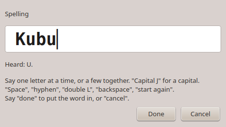
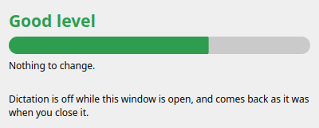

# Commands

Everything you can say. Dictation and the commands are in English only. Back to the
[README](../README.md).

- [How dictating works](#how-dictating-works)
- ["What can I say?"](#what-can-i-say)
- [The commands](#the-commands)
- [Selecting and correcting](#selecting-and-correcting)
- [Punctuation](#punctuation)
- [The spelling box](#the-spelling-box)
- [This program's own windows](#this-programs-own-windows)
- [The microphone level](#the-microphone-level)
- [Your own words](#your-own-words)
- [Clicking by name](#clicking-by-name)
- [Your own shortcuts](#your-own-shortcuts)
- [Your own commands](#your-own-commands)
- [Commands only](#commands-only)

## How dictating works

1. Click into a document, in one of the programs it works with: see
   [Programs](PROGRAMS.md).
2. Say **"wake up"**. The tray icon turns green.
3. Talk in phrases. Text appears each time you pause.
4. Say **"go to sleep"** when you are done.

Words go to whichever supported window is in front. While it is awake, resting the
mouse on the tray icon says which program that is, and what was last heard. It looks
every few seconds, so the tip is right before you speak. Asleep, the tip doesn't say
where words would go: it says that dictation is asleep, and what to say to wake it.

If no such window is in front, the words are not typed anywhere. A notice on screen says
that there is nothing to type into and names the programs that would do, at most once a
minute, and the icon's tip says "(nothing to type into)" after the words it heard.

**The words are fitted to where the cursor is.** After a full stop the next phrase
starts with a space and a capital, and in the middle of a sentence it doesn't. One thing
is left to you: words put in front of a sentence that is already there leave that
sentence's capital where it was. Put "yesterday" before "The cat sat" and it reads
"Yesterday The cat sat".

The recogniser gives the first word of every phrase a capital. In the middle of a
sentence that capital is taken off again, unless it belongs to a name: "I will see you"
and then "Next Monday" gives "I will see you next Monday". These keep it:

- one of your own words, listed under My words;
- a name the dictionary knows with another capitalised word after it, as in "Mark
  Jones", or by itself after a greeting, as in "Hello" and then "Mark";
- a word that names begin with, before another capitalised word: "New Zealand", "Uncle
  Bob", "Lake Taupo";
- a month where a date fits: "in" and then "May".

It is not always right. "Will Mark be there?" said in the middle of a sentence keeps the
capital of "Will", and a phrase that begins with "Windows" keeps that capital whether
the program or the glass is meant.

**A command is a phrase said on its own**, with a short pause before and after. Said in
the middle of a sentence, the same words are just typed: "I will scratch that idea" is
dictation. Punctuation words, "new line" and "new paragraph" are different: they are
meant to be said as you go, and work inside a sentence too.

A command need not be said in exactly one way:

- **"Please"** may come first or last: "scratch that, please".
- **A word said without thinking** before a command of two words or more is passed
  over: "um", "uh", "er", "erm", "oh" or "OK". So "OK, scratch that" is a command. "No"
  is passed over only where you paused after it, which the recogniser writes as a comma:
  "No, scratch that" is a command, and "No new line here" is a sentence. "And" is never
  passed over: "And select all" is typed.
- **"The"** may be said or left out: "go to the end of the line", "go to end of line".
  A phrase that ends with "the" is the start of a sentence that a pause cut short, and
  is not taken for a command: "Undo the" is typed. "Down the line" is typed too: it is
  a thing people say, and "down 3 lines" is the command.
- **A count** may be a figure or words, up to ninety-nine: "delete last three words",
  "go to line forty two". A count bigger than a command takes is taken as the most it
  takes: "backspace 100" removes 99 characters.
- **Said twice in one breath**, as in "scratch that, scratch that", a command is done
  once. ("New line" and "new paragraph" said twice give two.)

**Notices.** A brief notice on screen says what happened where there would otherwise be
nothing to see:

- `Selected: the black cat` after "select" or "correct", since what you say next will
  take the place of those words.
- `Say a number, 1 to 3, or "cancel".` when the words were found in several places.
- `Writer can't do "duplicate line".` when the program in front has no such command, or
  why a command couldn't be done: `"bold that" couldn't be done: plain text has no
  formatting.`
- That there is nothing to type into, as above.

**A click on the tray icon** wakes dictation when it is asleep or off, and switches it
off when it is awake. Off means the microphone is closed. A right-click gives the menu:
turning the microphone on and off, waking and sleeping, the microphone level, Settings,
"What can I say?", "Getting started" (the welcome window again), the log, About, and
Quit.

Any command, and any punctuation word, can be switched off in Settings. Unticked, the
words are typed as ordinary text. Rest the mouse on a line in Settings, or move to it
with the Tab key, and a tip says more about it.

## "What can I say?"

**What can I say?** in the tray icon's menu opens a list of everything that can be
said, grouped as Settings groups it. Saying **"what can I say"** opens it too. Type a
word in the box at the top, such as "select" or "comma", to narrow the list. Each line
gives the usual way of saying a command or a punctuation word and what it does, and
says so if it is switched off in Settings. The other ways of saying a command are on
this page.

## The commands

The table gives the usual form of each, and the commoner other forms.

| Say | What happens |
|---|---|
| wake up / go to sleep | Starts and stops dictation. These two can't be switched off |
| click OK, click save | Presses the button, link, tick box, tab or menu of that name in the program in front. Off until ticked in Settings: see [Clicking by name](#clicking-by-name) |
| wake / sleep | The same, in one word each, if **"Wake", "sleep"** is ticked in Settings. It is off to begin with: a lone "sleep" can then no longer be dictated, and one word is a little easier to set off by accident than two. "Wake up" and "go to sleep" go on working |
| scratch that | Removes the last phrase; say it again for the one before. A phrase said over selected words gives them back: see [Selecting and correcting](#selecting-and-correcting) |
| that was a noise | Takes back what a rustle or a click was written as, and keeps the sound on this computer (see [Speech models](MODELS.md#that-was-a-noise)). Off until ticked in Settings |
| undo that | Undoes the last change. Also "undo", "undo it" |
| redo that | Does again what "undo that" has just taken back: the program's own Redo (in Kate, the phrase "undo that" took back goes in again). Also "redo", "redo it" |
| backspace, backspace 3 | Removes characters before the cursor, 99 at most |
| tab, tab 3, tab three times | The Tab key, once or several times, 20 at most. Also "press tab", "tab twice" |
| space, space 3 | The space bar, once or several times, 20 at most |
| enter | The Enter key, the same as "press enter". Off until ticked in Settings |
| delete last word, delete last 3 words | Removes words before the cursor. A price, a number or an address goes whole: after "costs $25.50", one word leaves "costs" |
| delete that | Removes the selection, or the last phrase if nothing is selected |
| select *words* | Selects those words near the cursor: see [Selecting and correcting](#selecting-and-correcting) |
| correct *words* | Selects them as "select" does, for putting a mistake right without losing your place: see [Selecting and correcting](#selecting-and-correcting) |
| select that, correct that | Highlights the last phrase, so what you say next replaces it |
| unselect that | Clears the selection. Also "deselect that" |
| select all | Selects the whole document. Also "select everything" |
| spell that | Opens [the spelling box](#the-spelling-box). Also "spell it" |
| new paragraph, new line | Breaks. They work inside a phrase too |
| press enter | The Enter key |
| go to end of line / start of line | Moves the cursor. "Move to" and "jump to" work in place of "go to", and "beginning" in place of "start" |
| go to end of paragraph / start of paragraph | Moves the cursor; say again to carry on to the next |
| go to top / go to bottom | Moves to the start or end of the document. Also "go to the end of the document", "go to the start of the file" |
| move left 3 words, move right a word | Moves the cursor by words; "back" and "forward" work too |
| up one line, down 3 lines | Moves the cursor by lines, 999 at most |
| go to line 42 | Jumps to that line (VS Code, Kate, Word) |
| select line, delete line, delete 3 lines | Selects or removes whole lines. Also "select this line", "delete that line" |
| duplicate line, indent, outdent, comment line | Line editing in VS Code; "indent" and "outdent" work in Word too. Also "uncomment line", "indent that line" |
| cap that, all caps that, no caps that | Changes the case of the selection or last phrase. Also "capitalize that". "Cap that" gives each word a capital and keeps the capitals that are there: "the NASA report" becomes "The NASA Report". (In Word it is Word's own title case, which brings "NASA" down to "Nasa".) |
| bold that, italicize that, underline that | Formats the selection or last phrase (not in Kate or other plain text; in VS Code, bold and italic only, in Markdown files) |
| what can I say, open dictation settings, show microphone level, close that window | For [this program's own windows](#this-programs-own-windows) |

All of them are on to begin with, apart from the three marked as off. One thing can't
be said: a tab in the middle of a phrase, only by itself.

## Selecting and correcting

**"Select" and some words**, as in "select the black cat", highlights those words near
the cursor. A notice says what was selected. What you say next takes their place.

**"Correct" and some words** does the same, for putting a mistake right further up
without losing your place: say the new words and they take the place of the old ones,
then the cursor goes back to where it was. "Unselect that" goes back and leaves the
words as they were. Any other command leaves the cursor with the words ("space" is
taken for words).

**If the new words come out wrong, say "scratch that".** They go, and the old words are
back and selected again, as they were before you spoke: say the new words once more.
After "correct" the cursor still goes back to its place when you have, and "unselect
that" goes back and leaves the old words. It is the same for words you selected by
hand.

- In Writer the words come back just as they were, bold or a link among them, as long
  as nothing else has been done to the document since. Otherwise, and in Word and
  Outlook, they come back as their letters, looking like the text around them.
  Thunderbird keeps what is bold or a link where no space had to be taken out beside
  the words.
- In a box that is typed into (a browser, a chat box, Notepad) the words are typed
  again. That is done for words on one line, up to 3000 characters (300 where keys go
  in one at a time), and on Linux for words the keyboard can type: not "café". After
  "correct" it also needs the text between the cursor and the words to be as it was.
  Where it can't be done, the phrase only goes, or you are told there is nothing to
  scratch.
- "Undo that" is still the program's own Undo, whatever that takes back, and "redo
  that" its Redo.

**The words need not be written the way you said them.** Where they are there just as
you said them, that place is taken. Otherwise these are found as well:

- words that sound the same: "select two" finds "2", "to" and "too";
- a number written the other way: "twenty one" finds "21", and "1250" finds "1,250";
- British and American spellings: "color" finds "colour";
- initials without their dots: "US" finds "U.S.", and "pm" finds "p.m.";
- a title said in full: "doctor" finds "Dr.";
- a word without its apostrophe or accent: "dogs" finds "dog's", and "cafe" finds
  "café".

Visual Studio Code and Thunderbird look for the words themselves, and for exactly
those. They are asked again for words that sound the same, for a number written the
other way, for the other spelling and for a title written short, so those are found
there too. Initials are found there when the recogniser writes what you said with the
dots, as in "Select U.S." or "Select p.m.": the two programs are then asked for the
letters apart as well. When it writes "Select US", "U.S." is not found in those two.
Nor is "dog's" by "dogs", or "café" by "cafe". Select the word beside it there, and
carry on from that.

**When the words are in several places**, a small number appears over each of the
nearest, and a notice asks for a number.

- Say the number: "two", "number two", "second", "the second one".
- "Cancel", "never mind", "none" or "neither" takes the numbers away. So does waiting
  twenty seconds.
- A single word that is neither a number nor a command is not typed: the number was
  most likely misheard, as "to" or "for" or "tree", so the numbers stay and the notice
  asks again. A one-word shortcut of your own is still a shortcut.
- A command, or two words or more, takes the numbers away and is then done or typed as
  usual.

Kate, KWrite and boxes that are typed into show no numbers, and take the nearest place.
Untick **Show numbers to choose from when several places match** in Settings to have
the nearest taken everywhere.

**A sentence can still begin with "Select" or "Correct".** What you said is typed, and
nothing is selected, when:

- the words after it aren't found near the cursor, as in "Correct me if I'm wrong";
- the recogniser wrote a comma or other punctuation straight after the word, as in
  "Correct, yes.";
- more than eight words follow it.

If the words are there, it is the command: "Select Save." selects a "save" that is near
the cursor. The notice tells you so, and "unselect that" puts it right.

## Punctuation

Punctuation is said by name while dictating. Each line of this table is one tick box
under Punctuation in Settings.

| Say | Types | To begin with |
|---|---|---|
| full stop | `.` | on |
| period | `.` | off |
| comma | `,` | on |
| question mark | `?` | on |
| exclamation mark, exclamation point | `!` | on |
| colon | `:` | on |
| semicolon | `;` | on |
| hyphen | `-` | on |
| ellipsis | `…` | on |
| open bracket, close bracket; open paren, close paren | `(` `)` | on |
| open quote, close quote | `“` `”` | on |
| quote, unquote (or "end quote") | `“` `”` | off |
| open single quote, close single quote | `‘` `’` | on |
| open square bracket, close square bracket | `[` `]` | on |
| open curly bracket, close curly bracket; open brace, close brace | `{` `}` | on |
| dash | `–` with a space either side | off |
| em dash, en dash | `—` `–` with no spaces | on |
| slash | `/` | off |
| forward slash, backslash | `/` `\` | on |
| apostrophe | `'` | on |
| at sign | `@` | on |
| ampersand | `&` | on |
| percent sign | `%` | on |
| hash sign, number sign | `#` | on |
| dollar sign, euro sign | `$` `€` | on |

"New line" and "new paragraph" work inside a phrase as well, and have their tick boxes
under Line breaks. "Newline" written as one word is the command when it is said by
itself. Inside a sentence it is the word, as in "strip the trailing newline".

**The four that are off** are everyday words as well: "a trial period", "a dash to the
shops", "slash prices", "quote me a price". If you say "period" and not "full stop",
tick it in Settings. "Quote" opens a quotation, or closes one that is open, so it does
for both. "Parenthesis" works in place of "paren". There is no "pound sign", because it
means £ to some and # to others: say "hash sign".

**Spaces are fitted to each sign.** A hyphen, a slash, an "@" and the em and en dashes
join the words either side: "and forward slash or" gives "and/or", and "pages five en
dash ten" gives "pages five–ten". An apostrophe joins the word before it, and a
following "s" or "t": "the dog apostrophe s bone" gives "the dog's bone". A "#", "$" or
"€" joins what follows it, and a "%" what comes before. A backslash joins what follows
it, and has a space before it, as in "ends with \n", except inside a file path, where
it joins both: "open C colon backslash users" gives "open C:\users". An ampersand has
a space either side.

**A punctuation word stays a word where the sentence is talking about it.** After "a",
"an", "the" or "the word" it is left alone: "put a comma there", "the word colon",
"press the comma key". So are a few everyday phrases, such as "colon cancer", "a trial
period" and "at sign in". Anywhere else in a sentence it becomes the sign: "comma key"
without "the" has a comma in it, and "period", once switched on, is a full stop in most
places. To type the word itself, say "literal" first: "literal comma".

Three things after "a" or "the" are signs all the same:

- a hyphen inside a word that is made with hyphens: "state hyphen of hyphen the hyphen
  art" gives "state-of-the-art";
- an opening quote or bracket whose closing one comes later in the phrase: "a open
  quote quick close quote fix" gives "a “quick” fix";
- what follows the letter A at the start of a sentence, where another letter or a
  figure comes next: "A comma B comma and C".

Two that still go wrong: "A colon the first option", at the start of a phrase, keeps
the word "colon", because of the "A" before it; and "The house number sign fell off"
types a "#".

The recogniser adds commas of its own inside a phrase, and they are kept, with one
exception: the comma it puts after a greeting, as in "Hello, Bob", is left out, giving
"Hello Bob". It is the same after "hi", "hey", "hello there", "greetings", "welcome",
"good morning", "kia ora" and "g'day". "Hello, how are you", "Hello, Monday works for me" and "Cheers, Bob" keep
theirs. Further on in a sentence it goes too, after "hello", "hi" and "hey", where the
name ends what is said or is joined on to more: "so if I say hello Jill and I say hello
Peter". Where the name begins something new the comma stays, as in "I said hello, Bob
said goodbye". Untick **No comma after Hello or Hi** in Settings to have it back.

### At the end of a phrase

A recogniser hears each phrase by itself, cut where you paused, and ends nearly every one
with a full stop, as if it were the whole of what you said. But a pause in the middle of
a sentence, to think, gets one too, with a capital after it: "it should be an option.
That the user can select." Settings has three ways to have it, under Formatting: **Full
stops at the ends of phrases**.

- **Only where I say "full stop"** (to begin with): the recogniser's stop is left off,
  and you say "full stop" or "question mark" where you want one. Nothing is ever put in
  wrongly, but a sentence only ends where you say so.
- **Where the words show a sentence has ended**: the recogniser's stop is held back
  until you say your next words, and then the words decide. A pause in the middle of a
  sentence gets no stop and no capital ("an option that the user can select"); where a
  sentence did end, the stop goes in with the next words, and they start with a capital.
  It can also be a comma. The last sentence gets its stop after about three seconds of
  quiet, or when you say "new line" or "new paragraph", or put dictation to sleep; if you
  then carry on with the same sentence, that stop is taken out again. "Full stop", said,
  always ends a sentence there.
- **At every pause, as the recogniser writes them**: its stops are kept. That suits
  short messages said in one go; expect a stray full stop where you paused part of the
  way through a sentence.

What decides, in the second way, is a small punctuation model made for speech
recognition (7.6 MB, downloaded the first time that way is chosen), which looks at the
last thirty words or so and the first words of your next phrase. Over dictation recorded
for the purpose (read sentences cut at real pauses and in mid-sentence, and written
dictation of emails, notes and technical text), it put the right mark at 89 of every 100
sentence ends it marked, where keeping the recogniser's gets 49, and the stray full stops
at pauses in the middle of a clause fell from 82 in 100 to 3. Mistakes in marks and
capitals together fell from 15 to 5 in 100 words. It decides in a few thousandths of a
second.

The rest of this section is about the first way, which is what you have unless you
choose another.

A shortening keeps the full stop that is its own: "We met at 5 p.m." ends with its
stop, and so do "etc.", "U.S." and "Ph.D.". That stop does not say whether the sentence
ended there, so it goes by what you said:

- If you only paused, the next phrase carries on with the sentence, in small letters:
  "at 3 p.m." and then "On Tuesday" gives "at 3 p.m. on Tuesday".
- If you said "full stop" after it, the next phrase starts a sentence with a capital.
  No second stop is typed, whether you say "at 3 p.m. full stop" in one phrase or "full
  stop" by itself afterwards.

This is remembered from one phrase to the next, for as long as the text before the
cursor still ends with what was last typed there. Where it can't be known, as after you
have clicked somewhere else, the phrase after "p.m." gets a capital unless it begins
with a word that seldom starts a sentence, such as "and", "to" or "from".

Words put into the middle of a sentence never get a full stop at their end, whichever
way is chosen.

**Dictation samples.** How well any of this does depends on how you dictate: where you
pause, and what your recogniser writes. Settings has **Record dictation samples…**: you
dictate an email or a message into its box as you naturally would, put the text right
to what you meant, and keep it. The sound of each phrase is kept with what was written
for it and what you meant, on your computer only. Then

    python scripts/check_punctuation.py

(with the install's own Python, from its folder) types each sample again each of the
three ways and says how many full stops, commas and capitals each got right and wrong.
`--show` shows each sample as it would be typed. Make up what you dictate there: it is
kept, sound and all, on your computer only. The window lists what is kept, with the text
you meant on resting the mouse on one, opens the folder they are in, and deletes one or
all of them.

If you pause before saying "question mark", the recogniser sometimes writes the sign and
not the words, which would then be dropped too. So when a phrase ends with a pause and a
few last words, and no punctuation word came out, those last words are listened to once
more by themselves. That takes well under a second.

## Putting right what was just typed

A phrase is heard and typed by itself, and what you say next can show that part of it was
wrong. Two things are done about that, each with a tick box in Settings.

**Put right what was just typed when the next words show what it was** (under
Formatting). As a new phrase goes in, the end of what was typed before it is looked over
again with the new words beside it:

- a word that should have been another that sounds the same: "take the cat too", and then
  "the vet", becomes "take the cat to the vet";
- a full stop that the recogniser put at the end of a phrase, when the next one goes on
  with a comma: "Hi Joe." and then ", how are you" becomes "Hi Joe, how are you". A stop
  that you said stays.

**Hear a sentence again in one piece when it was said in two** (under Speed). A sentence
said with a pause in the middle is heard as two halves, and each half lacks what the other
would have told the recogniser: over 128 read sentences cut at a pause, that made nearly
four times as many words wrong as hearing them whole. So when the second half has been
typed and nothing else is waiting, the two sounds are put together and heard once more.
If a word or two comes out differently, the two phrases are typed again. It is only done
when the recogniser is quick enough for it to take under half a second, so it never holds
up what you say next by more than that; on a slow computer that does its own listening it
is mostly left out. It is not yet done in a box that is typed into key by key, such as a
form in a browser.

Neither will fight you:

- Only this program's own words are touched, and only while they are exactly as it typed
  them. Change a word back by hand and it is left alone from then on.
- "Scratch that" takes away the phrase and any change that came with it. Said twice over
  the same change, the change is not made again there.
- "Undo that" straight after a change says it was not wanted: it is not made again in
  those words, and a kind of swap undone in two places is not made anywhere until the
  program is started again.

## Sums of money

A recogniser doesn't write money the same way twice: "one hundred and twenty dollars"
comes out as $120, and "a hundred and fifty dollars" in words. So a sum of money is
always put in figures, whichever way it was written:

| Said | Typed |
|---|---|
| a hundred and fifty dollars | $150 |
| twenty dollars and fifty cents | $20.50 |
| two thousand five hundred dollars | $2,500 |
| one point five million dollars | $1.5 million |
| twenty or thirty dollars | $20 or $30 |
| two or three hundred dollars | $200 or $300 |
| a hundred NZ dollars | NZ$100 |
| three hundred Australian dollars | AU$300 |
| fifty US dollars, fifty Canadian dollars | US$50, CA$50 |
| a hundred euros | €100 |
| a hundred UK pounds | £100 |
| twenty pounds sterling and fifty pence | £20.50 |
| a twenty dollar note | a $20 note |

Only where a whole number stands straight before the money's name. "A few dollars",
"millions of dollars" and "a dollar" stay as they are, and so does "a hundred dollar
bill", where the "a" belongs to the bill.

Pounds are written as money only where you say so: "UK pounds", "British pounds" or
"pounds sterling". "A hundred pounds" by itself may be a weight, so it is left in words.

To have sums left as the recogniser wrote them, untick **Write sums of money as figures**
under Formatting in Settings.

## The spelling box

"Spell that" opens a small box for a word the recogniser doesn't know.



Say letters one at a time or several together. Letter names and the radio alphabet both
work, and so do the figures zero to nine.

- **Capitals.** "Capital J" gives a capital. "All caps N A S A" puts the rest of what
  you say in capitals.
- **Making a letter clear.** B, D, E, G, P, T and V sound alike, and no recogniser
  tells them apart every time. "B for bravo" and "B as in boy" give one b, and it is
  the word that settles which letter: said so, a letter can't be mistaken. "Bravo" by
  itself does the same.
- **Doubles.** "Double L" gives two. "Double U" is the letter W, however the
  recogniser writes it. For two of the letter u, as in "vacuum", say "U U".
- **Accents** are said after the letter: "e acute" gives é and "a macron" gives ā.
  "Grave", "umlaut", "circumflex" and "cedilla" work the same way.
- **Signs.** "Space", "hyphen", "apostrophe", "underscore", "dot", "at", "comma",
  "colon", "semicolon", "slash", "backslash", "ampersand", "plus", "equals", "hash",
  "percent", "dollar", "asterisk", "open bracket", "close bracket", "question mark"
  and "exclamation mark".
- **Putting it right.** "Backspace" takes off the last one, and "start again" clears
  the box.

"Done" puts the word in, "cancel" doesn't.

## This program's own windows

So that its windows can be worked without the mouse:

| Say | What happens |
|---|---|
| what can I say | Opens the list of everything that can be said |
| open dictation settings | Opens Settings. Also "dictation settings" |
| show microphone level | Opens the microphone level. Also "show the level meter" |
| close that window | Closes whichever of this program's windows is in front, or the one opened last. With none open, the words are typed like any others |

They are one tick box in Settings, under "This program's windows", and it is on to
begin with. "Close that window" never closes the spelling box, or the small window that
stands in for the tray icon on a desktop without a tray.

The windows can be worked from the keyboard too: the Escape key closes a window, Enter
presses the button that has the keyboard, and Alt with an underlined letter presses
that button or jumps to that part of Settings.

## The microphone level

The microphone level is a small window for trying your microphone, opened from the tray
icon's menu or by saying "show microphone level". It opens the microphone by itself and
shows how loud your voice is as you speak, with the same bar as the reading window: grey
and blue for too quiet, green for a good level, yellow, orange and red as the microphone
runs out of room. Above the bar each phrase is judged in words, with what to do about
it. If the microphone can't be opened, the window says why, and tries again every two
seconds.



Dictation is off while the window is open, so nothing you say to it is typed, and comes
back as it was when you close or minimise it. Asking for dictation from the tray icon
closes it for you. Since nothing said can close it, it closes by itself when nothing
has been heard for a minute, and counts down in words for the last fifteen seconds:
say something to keep it open.

The tray icon shows the level too while you speak, as a bar along its foot, which turns
red when the microphone is too loud.

## Your own words

Names and unusual words are often misheard: "Joe" comes out as "Jo", and "Johnny" as
"John E" or a made-up "Junny".
List such words under **My words** in Settings, one to a line, spelled the way you want
them typed.

They are used where they fit. "Cheers, Johnny" gets the name, and "a rose in the garden"
still gets the ordinary word. To tell, a phrase that comes out with one of your words in
it is listened to a second time without the list, and the two are compared. Your word
stays if the second hearing wrote a name there or a word it didn't know, if a greeting or
sign-off comes just before, or if you said the word by itself. Such phrases take about
twice as long to appear. Keep the list short: forty words at most.

Some things are never turned into one of your words:

- **An everyday word** in the run of a sentence: with "Dan" on the list, "I'm done"
  and "Thanks, done." stay as they are. Only where the word is all that follows "Dear"
  or "Hello", which little but a name does, is it taken for yours: "Dear Dan,".
- **What people say in place of a name**: "Hi team," and "Hello everyone" stay as they
  are.
- **A command**: with "Andy" on the list, "undo" is still "undo".

**Capitals.** One of your words keeps the capital you gave it wherever it comes, also
as the first word of a phrase said in the middle of a sentence: with "Rose" on the
list, "I spoke to" and then "Rose" gives "I spoke to Rose", not "rose". A word you
wrote with a small first letter and a capital later ("iPhone", "vLR5340") keeps its
small letter at the start of a sentence.

**Part numbers.** A word with letters and figures in it, three characters or more, such
as "vLR5340", "MP3" or "CO2", is not a name. It is put in as you spelled it wherever
the recogniser wrote the same letters and figures, however it split them up or wrote
them out: "VLR 5340", "VLR-5340", "V L R fifty three forty". With any recogniser, and
with no doubt to settle, so no second hearing. The letters have to be written the way a
code's are, and an everyday word's are not: joined to the figures, in capitals, or as
the names of letters. So with "A380" on the list, "a 380 pound gorilla" is left alone,
and with "Win11", so is "we win 11 games".

**With Parakeet.** Parakeet can't be given the list, so there is one hearing and no
second to compare. Your word is put in by its sound, where Parakeet wrote a name or a
word that the dictionary doesn't know ("I spoke to Johnie" or "I spoke to John E", for
Johnny), or where the word was said by itself, or right after a greeting or a sign-off
("Cheers," or "Best wishes," and then "Johnie").

- **Another spelling of the same name is yours.** The list is there to put right a name
  that the recogniser spelled the usual way: with "Sarah" on the list, "Sara" becomes
  Sarah, and with "Jon", "John" becomes Jon. Two spellings count as one name when their
  consonants are the same, their first vowels are of the same kind, and they have as
  many syllables.
- **A name that only resembles yours is somebody else's, and stays.** With "Dan" on the
  list, "Don" and "Dean" are left, and so are "Tim" with "Tom" listed and "Maria" with
  "Mary".
- **Two words heard for one of yours are joined**: "Libre Office" becomes "LibreOffice".
  At the very start of a sentence they are joined only if the first of them is no
  everyday word: "Git Hub is down" is left as it is there, though "I use Git Hub"
  becomes "I use GitHub".

At the very start of a sentence a name and an everyday word can't be told apart by
capitals, so the system's dictionary decides. (Windows has none, so the installer
fetches one.) Where there is no dictionary at all, your word wins there.

## Clicking by name

Tick **"Click" and the words on a button, link or menu in the window in front**, under
**Other programs** in Settings, and you can press what a window shows by saying "click"
and its name: "click OK", "click save", "click file", "click remember my choice".

- It works on buttons, links, tick boxes, tabs, menus and the things in lists. The
  window in front is asked what it has, through the desktop's accessibility service
  (the one screen readers use), and the one you named is pressed through the same
  service. No mouse is moved.
- Say the name it shows. The start of a name will do: "click save" presses "Save", or
  "Save As..." where there is no "Save". Of two names that fit, the shorter is taken.
  "Click the save button" and "click on save" mean the same.
- What is greyed out, or not showing, is not pressed.
- If nothing in the window has that name, what you said is typed like any other words,
  so "Click here to see more" can still be dictated. A phrase of more than six words
  after "click" is always taken for a sentence.
- Not every program says what is in its windows. Where one doesn't, nothing can be
  found in it. On Linux the accessibility service has to be on, which the tick box for
  dictating into other programs' text boxes sees to.

## Your own shortcuts

A few words of your own can stand for a longer text of your own: say "my address" and
your address is typed. They are listed under **My shortcuts and commands** in Settings,
one to a line: what you say, an equals sign, what is typed.

```
my address = 12 High Street
    Dunedin 9016
sign off = Kind regards, and thank you for your time.
```

- A line that begins with a space carries on the text of the line above, as a new line
  of it. That is how an address of several lines is written.
- The words have to be said by themselves, as a phrase of their own, like a command.
  Said in the middle of a sentence they are just words.
- The text is typed exactly as you wrote it: no punctuation words are looked for in it,
  and its last full stop and every letter of it are kept, small or capital, also at the
  start of a sentence. So an email address stays in small letters wherever it lands. A
  space is put before it where the text before the cursor needs one.
- A shortcut said the same way as a command takes the command's place, all but "wake
  up", "go to sleep" and "spell that".
- Empty lines, and lines that begin with `#`, are passed over. If a line can't be
  understood, Settings lists it under the box, and the rest are kept.
- They are saved a moment after you stop typing. There can be 200 of them, each up to
  2,000 characters long.

## Your own commands

In the same box, a line can do something where a shortcut types something: press keys,
open a file or a web page, or run a program. Write what is to be done after the equals
sign, beginning with the kind of thing it is:

```
new tab      = keys: ctrl+t
save all     = keys: ctrl+k ctrl+s
my notes     = open: ~/notes.txt
morning news = open: https://example.org/news
    wait: 2
    keys: ctrl+l
build it     = run: make -C ~/project
shut down    = ask first
    run: systemctl poweroff
```

| Written | What it does |
|---|---|
| `keys: ctrl+shift+t` | Presses keys held together, in the program in front. Several, one after another: `keys: ctrl+k ctrl+s` |
| `open: ~/notes.txt` | Opens a file, a folder or a web page with the program that usually opens it |
| `run: make -C ~/project` | Starts a program, with what is given to it, and leaves it running |
| `type: Notes for today` | Types a text, as a shortcut does: for a step among others |
| `wait: 2` | Waits so many seconds (up to 10), for a program to be ready for the next step |
| `ask first` | As the first step: you are asked, and the rest is done only if you say "yes" |

- A line that begins with a space, under a command, is a further step, done after the
  one before. There can be 12. If a step can't be done, a notice says so and the rest
  are left.
- To type a text and press Enter after it, write the text and put the key under it:

  ```
  git status = git status --short
      keys: enter
  ```

  Under a text, a line of `keys:` or a `wait:` is a step; any other line is another
  line of the text, as in an address. Nothing is escaped in a text, so `\n` is typed
  as those two characters.
- The keys are `ctrl`, `shift`, `alt`, `win`, the letters and figures, `f1` to `f12`,
  `enter`, `tab`, `escape`, `space`, `backspace`, `delete`, `insert`, `home`, `end`,
  `pageup`, `pagedown`, `left`, `right`, `up`, `down`, `plus`, `minus`, `comma`,
  `period` and `slash`. On Linux the desktop asks, the first time, whether Linux
  Speaking may press keys: say yes, and it is remembered.
- Like a shortcut, a command has to be said by itself, as a phrase of its own, word for
  word. It works with [Commands only](#commands-only) ticked, too.
- "What can I say?" lists your shortcuts and commands with the rest, and what each does.

**Running programs is off until you switch it on.** A phrase can be misheard, and a
video can say it. So:

- `run:` lines do nothing until **Let my own commands run programs** is ticked, in the
  same box in Settings. Said before that, a notice says where the tick box is.
- A command that runs a program has to be two words or more: one short word is what a
  noise is most easily taken for.
- Only what you wrote is run. Nothing you say is passed to the program, and no shell
  reads the line: a `|` or a `>` in it is only a character given to the program. `~`,
  and names such as `$HOME` (`%USERPROFILE%` on Windows), are filled in.
- A notice says what was run or opened.
- Begin a command with `ask first` if it would be a nuisance to set off by accident.
  You then have ten seconds to say "yes" ("yes, do it" and "go ahead" will do); "no",
  or anything else, leaves it.

To type a text that begins with one of these words and a colon, begin the line with
`type:`.

## Commands only

If you want Linux Speaking for voice commands and not for dictation, tick **Commands
only** in Settings, in the **My shortcuts and commands** box, and write a few commands
of your own in the list above it. That is all there is to set up.

With it ticked, nothing you say is typed. Only commands are acted on: the ones that
come with Linux Speaking, and your own shortcuts and commands. Whatever else is heard is
left alone, so it also suits a room where other people are talking.

- It is chosen in Settings and nowhere else. Nothing that is said switches it, so
  nothing overheard can start typing into your work.
- It is kept: the program starts the way you left it.
- The tray icon shows a **C** while it is ticked, and its tip says that nothing is
  typed, so that nobody wonders why.
- "Wake up" and "go to sleep" work as always.
- Something said that is no command is noted in the icon's tip as "not typed", and a
  notice says so once a minute at most.
- Unticked, which is how it starts, what is no command is dictation, and is typed.
